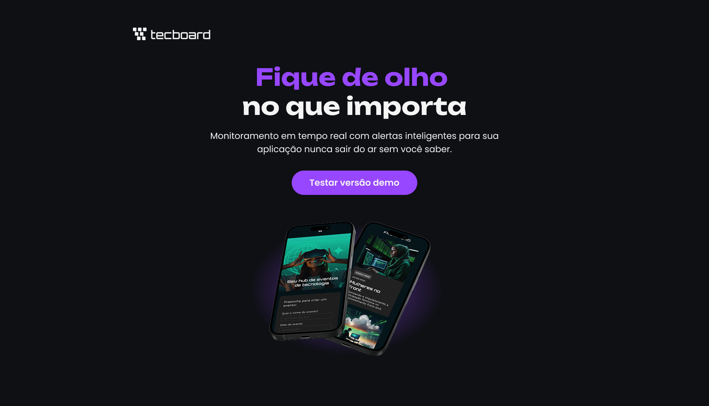

# Tecboard

-9cf?style=for-the-badge)


> **🎓 Projeto guiado:** desenvolvido acompanhando as aulas da formação de **Front-end da [Alura](https://www.alura.com.br/)**. O layout e a proposta são do curso; a implementação foi feita por mim, seguindo o professor.

Landing page de um evento de tecnologia, construída com HTML5 e CSS3 para praticar estruturação semântica, estilização e organização de uma interface a partir de um modelo de referência.

🔗 **[Ver projeto online](https://lpwesley.github.io/tecboard/)**

## 📸 Prévia



## 🛠️ Tecnologias

- **HTML5:** estrutura semântica da página
- **CSS3:** estilização, posicionamento e identidade visual
- **Git e GitHub:** versionamento e uso de branches
- **GitHub Pages:** publicação

## 📚 O que pratiquei

**HTML**
- Estrutura de página com elementos semânticos e divisão em seções
- Inserção de imagens, favicon e recursos visuais

**CSS**
- Cores, fontes personalizadas e espaçamentos
- Posicionamento, alinhamento e dimensionamento de imagens
- Organização dos estilos em arquivos separados

**Fluxo de trabalho**
- Separação entre estrutura (HTML) e apresentação (CSS)
- Organização de pastas e arquivos
- Versionamento com Git, uso de branches e deploy no GitHub Pages

## 📂 Estrutura

```text
tecboard/
├── css/
├── fonts/
├── img/
│   └── preview-tecboard.png
├── favicon-tecboard-roxo.svg
├── index.html
└── README.md
```

## 💻 Como executar

Não há dependências. Basta clonar e abrir no navegador:

```bash
git clone https://github.com/lpwesley/tecboard.git
cd tecboard
```

Abra o `index.html` no navegador ou use a extensão **Live Server** no VS Code.

## 🎓 Créditos

Projeto proposto pela **[Alura](https://www.alura.com.br/)** como parte da formação em Front-end. O design e o conteúdo base pertencem ao curso.

---

Desenvolvido por **Wesley Lauwer** · [GitHub](https://github.com/lpwesley)
